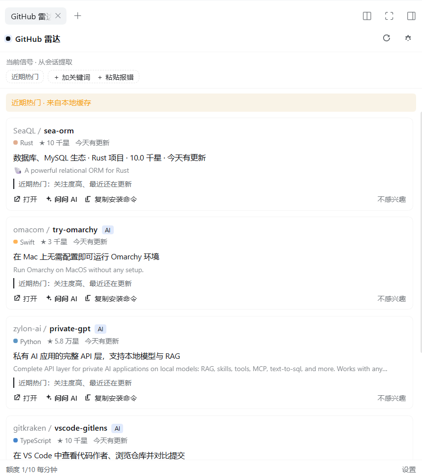

# GitHub Radar (dsh-github-radar)

A DeepSeek Harness plugin that opens a panel in the **right sidebar** and, based on what the current session is talking about, finds five relevant open-source projects on GitHub — with a one-line **Chinese** summary, a reason why it was picked, and an install command.




## Screenshots

The panel above, plus the entry it adds to the start page
(`assets/screenshot-start.png`). Both are declared in [`screenshots.json`](screenshots.json) so
storefronts show them in this order.

## Why

Looking for a library, hitting an error, or exploring an unfamiliar area usually means: open a browser tab, invent keywords, scroll search results. The radar turns that into a glance — the five cards are already there while you keep chatting.

- **Passive by design**: it never modifies the conversation, adds no agent tools and injects nothing into the system prompt.
- **Chinese-first copy**: the card body is one Chinese sentence (template-generated; optionally polished by a model and marked with an `AI` badge), with the original English description shown as dim secondary text.
- **Explainable**: every card says where it came from — "because you hit `Max retries exceeded`" / "because you mentioned `crawler`".
- **Restrained**: it reads the last three user messages only, extracts at most five keywords and one error line, and never sends raw chat text anywhere.

## Install

**From the plugin market** (search for `github-radar`): open *Settings → Plugins*, find **GitHub Radar**, install.

**From GitHub** (no npm needed, the built files are committed):

```bash
cd ~/.dsh/profiles/<your profile>
pnpm add github:nosleep00/dsh-github-radar
```

**From source** (for hacking):

```bash
cd ~/.dsh/profiles/<your profile>
pnpm add link:/absolute/path/to/this/repo
```

Then register the bundle in `package.json`:

```json
{
  "dsh": {
    "profile": {
      "bundles": ["...", "dsh-github-radar"]
    }
  }
}
```

Restart DSH (or enable it from the plugin manager) and a "GitHub 雷达" tab appears in the right sidebar.

## Use

1. Chat for a couple of turns — the "current signal" header shows the keywords and the error it picked up.
2. `↗ Open` loads the repository in the built-in browser tab; `⧉ Copy install` copies the install command; `Not interested` hides the repo for 30 days.
3. `⟳` for a fresh batch, `⚙` for settings.

## Settings

| Field | Meaning |
| --- | --- |
| GitHub read-only token | Optional. Anonymous search allows 10 requests/minute, with a token 30/minute |
| AI summary | On by default. Rewrites English descriptions with the session's model; falls back to the template per card on failure |
| Chinese projects only | Off by default. Filters by topic / Chinese description ratio, at the cost of recall |
| Allow network | When off, only the local cache is shown |
| Languages | Multi-select; matching repositories score higher |
| Min stars / cards | Defaults: 30 stars, 5 cards |
| Proxy URL | Uses undici's `ProxyAgent`, e.g. `http://127.0.0.1:8080` |

## Data & privacy

- Everything the plugin knows lives in `$DSH_HOME/plugin-data/dsh-github-radar/`: `cache.json` (last 40 batches), `feedback.json` (dismissed repos, clicks), `summaries.json` (model summaries), plus diagnostics (`boot.json`, `requests.jsonl`, `client-errors.jsonl`).
- Only query strings go to `api.github.com`: no chat text, no code, no file paths, no session ids.
- The optional AI summary sends the repository's public name/description/topics to the model already configured for the session — nothing from your conversation.
- No telemetry, no analytics, no auto-update ping: apart from GitHub and (optionally) the session's model, nothing else is contacted.
- Deleting that directory resets the plugin; nothing leaves the machine when you uninstall it.

## Development

```bash
pnpm install
pnpm typecheck     # tsc --noEmit
pnpm test          # vitest: 7 files / 111 tests
pnpm build         # tsc -> dist/host/*.js
```

- The host half is TypeScript compiled into `dist/host/`. The client half, `client/client.js`, is a hand-written `__ModuleLoader__` module (it only requires `react`) and is not bundled.
- End-to-end smoke test against the real API (not part of CI): `node scripts/probe-host.mjs`.

```
src/host/      index (plugin shell + /radar routes), engine (refresh state machine),
               signals (session -> keywords), query (query builder), github (rate-limited client),
               rank (scoring + cards), zh (Chinese templates), summarize (AI summaries), store (cache)
client/        client.js (sidebar pane + settings panel)
locale/        zh-CN.json / en.json
test/          vitest suites
docs/          plan, mockup, execution log
```

## Limitations

- v1 is a passive panel: no agent tools, the model does not proactively recommend repositories.
- "Chinese projects only" relies on topics and description language, so recall is imperfect.
- AI summaries need the host's `llm` service; without it the template summary is used.

## License

GPL-3.0-only — see [LICENSE](LICENSE). The full text of the GNU General Public License
version 3 is included verbatim; SPDX identifier: `GPL-3.0-only`.

Copyright (C) 2026 dsh-github-radar contributors.
