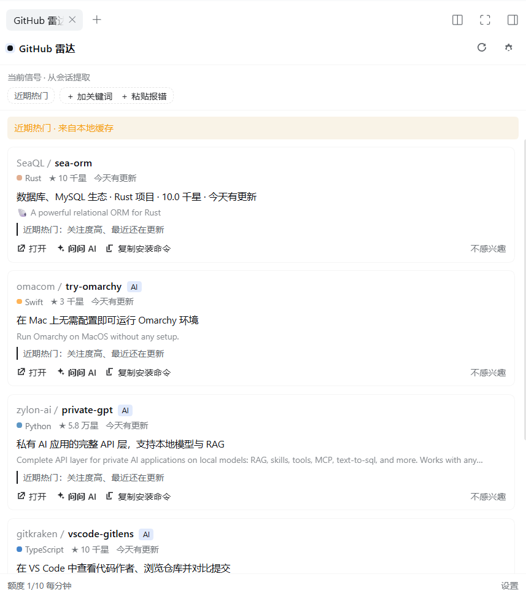

# GitHub 雷达（dsh-github-radar）

DeepSeek Harness 插件：在**右侧栏**开一个面板，根据你当前会话在聊什么，自动去 GitHub 找 5 个相关的开源项目，用**中文**告诉你「这是什么」「为什么推荐」「怎么装」。




## 截图

上面是面板本体；`assets/screenshot-start.png` 是它在开始页里的入口。两张图都在
[`screenshots.json`](screenshots.json) 里按顺序声明，市场详情页会照这个顺序展示。

## 它解决什么

遇到报错、想找一个现成的库、想知道某个领域有什么好项目——现在得自己切浏览器、想关键词、翻搜索页。
这个面板把这一步变成「抬眼一看」：会话里提到的东西，右边就已经是 5 张卡片了。

- **被动出现**：不改你的对话，不给模型加工具，也不往 systemPrompt 里塞东西。
- **中文优先**：卡片正文是中文一句话摘要（模板生成，可选用模型润色并带「AI」角标），英文原文折叠显示为灰色小字。
- **为什么推荐**：每张卡片都写明来源——「因为你在会话里遇到了『Max retries exceeded』这类问题」/「因为你在会话里提到『爬虫』」。
- **克制**：只读取最近 3 条用户消息，抽出最多 5 个关键词和 1 行报错；原始聊天内容不出本机进程。

## 安装

**从插件市场装**（搜索 `github-radar`）：打开 *设置 → 插件*，找到 **GitHub 雷达**，安装即可。

**从 GitHub 装**（不需要 npm，构建产物已随仓库提交）：

```bash
cd ~/.dsh/profiles/<你的 profile>
pnpm add github:nosleep00/dsh-github-radar
```

**从源码装**（自己改代码时）：

```bash
cd ~/.dsh/profiles/<你的 profile>
pnpm add link:/绝对路径/到这个仓库
```

然后在 `package.json` 的 `dsh.profile.bundles` 里加上包名：

```json
{
  "dsh": {
    "profile": {
      "bundles": ["...", "dsh-github-radar"]
    }
  }
}
```

重启 DSH（或在插件管理里启用）后，右栏会多出一个「GitHub 雷达」标签。

## 用法

1. 聊几轮——面板顶部的「当前信号」会显示它抽到的关键词和报错。
2. 卡片出现后：`↗ 打开` 在右栏内置浏览器里打开仓库；`⧉ 复制装法` 复制安装命令；`不感兴趣` 30 天内不再出现。
3. `⟳` 换一批；`⚙` 打开设置。

## 设置

| 项 | 说明 |
| --- | --- |
| GitHub 只读令牌 | 可选。匿名搜索限速 10 次/分钟，配令牌后 30 次/分钟。只需 `public_repo` 以内的只读权限 |
| AI 摘要 | 默认开启。用当前会话的模型把英文描述改写成一句中文；失败逐条回退模板 |
| 只看中文项目 | 默认关闭。按 topic / 中文描述占比筛选，会牺牲召回 |
| 允许联网 | 关掉后只显示本地缓存 |
| 语言偏好 | 多选，命中会加分 |
| 最低星数 / 卡片数 | 默认 30 星 / 5 张 |
| 代理地址 | 走 `undici` 的 `ProxyAgent`，例如 `http://127.0.0.1:8080` |

## 数据与隐私

- 全部数据只在本机 `$DSH_HOME/plugin-data/dsh-github-radar/`：`cache.json`（最近 40 批）、`feedback.json`（不感兴趣 / 点击）、`summaries.json`（模型摘要），以及诊断文件（`boot.json`、`requests.jsonl`、`client-errors.jsonl`）。
- 只往 `api.github.com` 发查询字符串；不发聊天原文，不发代码，不发文件路径，不发会话 ID。
- 可选的 AI 摘要只把仓库的公开名称/描述/topics 交给当前会话已在用的模型，不含你的对话内容。
- 没有遥测、没有埋点、没有更新上报：除 GitHub 与（可选）会话模型外不联系任何第三方。
- 删掉那个目录就等于重置；卸载后不会留下任何外发数据。

## 开发

```bash
pnpm install
pnpm typecheck     # tsc --noEmit
pnpm test          # vitest：7 个文件 / 111 个用例
pnpm build         # tsc -> dist/host/*.js
```

- 主机端是 TypeScript，编译到 `dist/host/`；客户端 `client/client.js` 是手写的 `__ModuleLoader__` 模块（只 require `react`），不参与打包。
- 端到端自检（真实 GitHub，不进 CI）：`node scripts/probe-host.mjs`。

目录：

```
src/host/      index（插件外壳 + /radar 路由）、engine（刷新状态机）、
               signals（会话→关键词）、query（查询构造）、github（限速客户端）、
               rank（排序与卡片）、zh（中文模板）、summarize（AI 摘要）、store（本地缓存）
client/        client.js（右栏面板 + 设置页）
locale/        zh-CN.json / en.json
test/          vitest 用例
docs/          执行方案、设计稿、执行进度
```

## 已知限制

- v1 是被动面板，没有 agent 工具；模型不会主动「推荐仓库」。
- 「只看中文项目」依赖 topic 与描述语言，覆盖不全。
- AI 摘要需要宿主提供 `llm` 服务；没有时自动只显示模板摘要。

## 许可证

GPL-3.0-only —— 见 [LICENSE](LICENSE)。仓库内 LICENSE 是 GNU GPL 第 3 版的完整原文，
SPDX 标识符为 `GPL-3.0-only`。

Copyright (C) 2026 dsh-github-radar contributors。
